# Probably High-Value?


**Customer segmentation and 90-day lapse risk stored as a formally defined probabilistic database and queried in plain English.**


Course project for **Data Management and AI Integration (ABAI2009L)**, Bennett University (Aug–Dec 2026).


| Course Topic | Course Wording | What This Project Builds |

|---|---|---|

| **Topic 3 (Core): Data Mining and KDD** | *"Apply classification or clustering algorithms… perform knowledge discovery on structured data from a database"* | Logged 6-step SQL cleaning funnel (`sql/02_clean_views.sql`), temporal snapshot features (`S1`, `S2`, `S3` in `sql/03_features.sql`), K-Means & Gaussian Mixture Model segmentation (`src/segment.py`), depth-4 decision-tree surrogate (`src/rules.py`), and Platt-calibrated 90-day lapse classifier (`src/lapse.py`). |

| **Topic 1: Probabilistic and Uncertain Databases** | *"Implement a small probabilistic database with uncertain values; query using confidence levels or probabilistic inference"* | Block-Independent-Disjoint (BID) `segment_membership` table (`gmm` posteriors and `B = 100` `bootstrap` co-assignment probabilities summing to `1.0` per block), tuple-independent `lapse_risk` table, parameterised confidence queries `Q1`–`Q6` (`sql/templates/`), and a 10,000-world Monte Carlo possible-worlds verifier (`src/worlds.py`). |

| **Topic 2: NLP for Database Interaction** | *"Convert natural language queries to SQL; rule-based or pre-trained model like spaCy or NLTK"* | Deterministic `spaCy` (`en_core_web_sm` + `EntityRuler`) parser (`src/nl/`) that maps natural-language questions and published verbal probability hedges (*probably*, *very likely*, *almost certainly*) to typed, allow-listed SQL template parameters. |


---


## Architecture


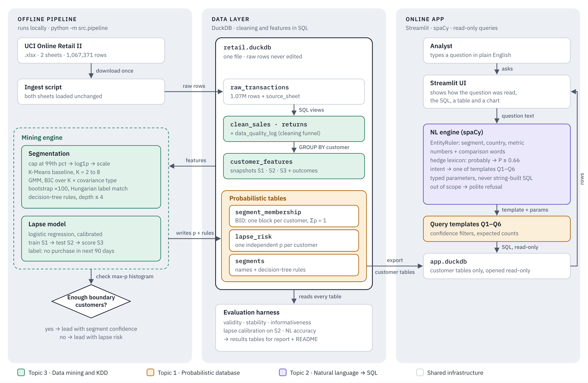


### End-to-End Pipeline & Query Flow


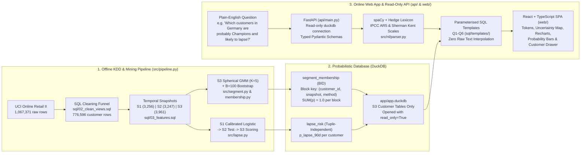


---


## Web Application Showcase (`docs/screenshots/`)


The application design follows the strict principle **"colour only means data"**, with neutral chrome in light and dark modes, Okabe–Ito colour-blind safe categorical hues for customer segments, a sequential red ramp for 90-day lapse risk, and self-hosted fonts (`Bricolage Grotesque`, `Figtree`, `JetBrains Mono`):


| Page | Light Mode | Dark Mode |

|---|---|---|

| **1. Overview** (`/`) · Headline finding, full-width S2 reliability diagram, command bar & segment summary strip | 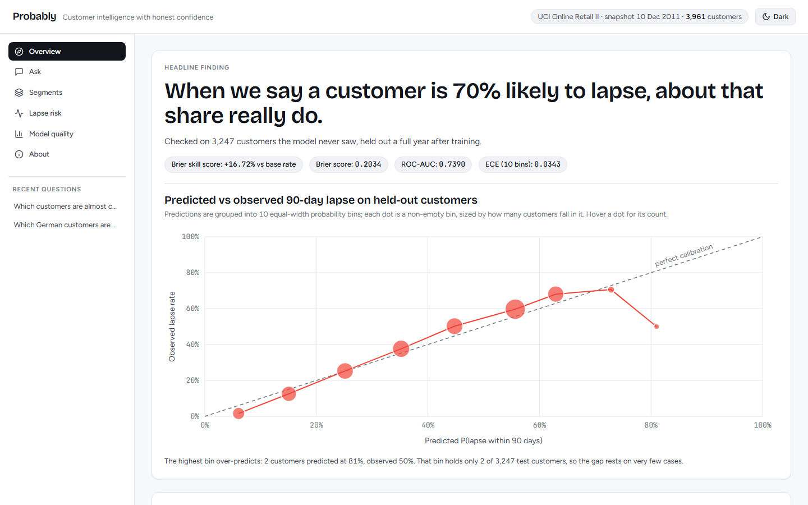 | 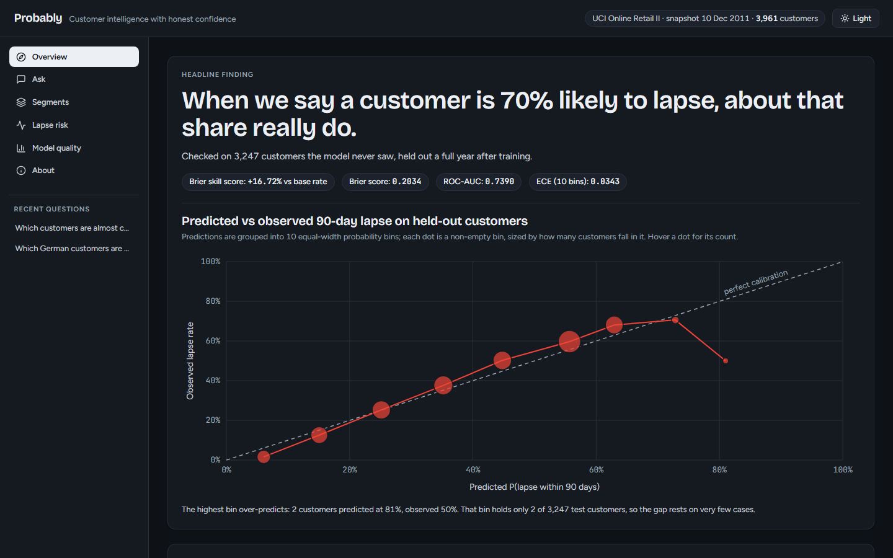 |

| **2. Ask (NL → SQL)** (`/ask`) · Interpretation sentence, ParseStrip tokens, threshold slider, matched summary & sortable results | 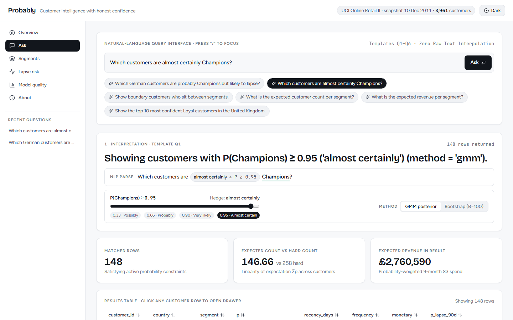 | 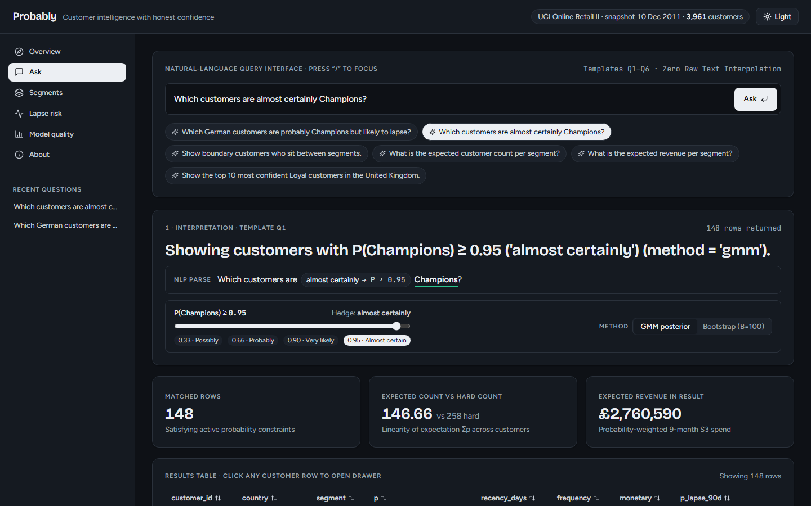 |

| **3. Segments** (`/segments`) · Full-width Uncertainty Map (3,961 customers on HTML5 canvas), 5 segment profiles & expected size chart | 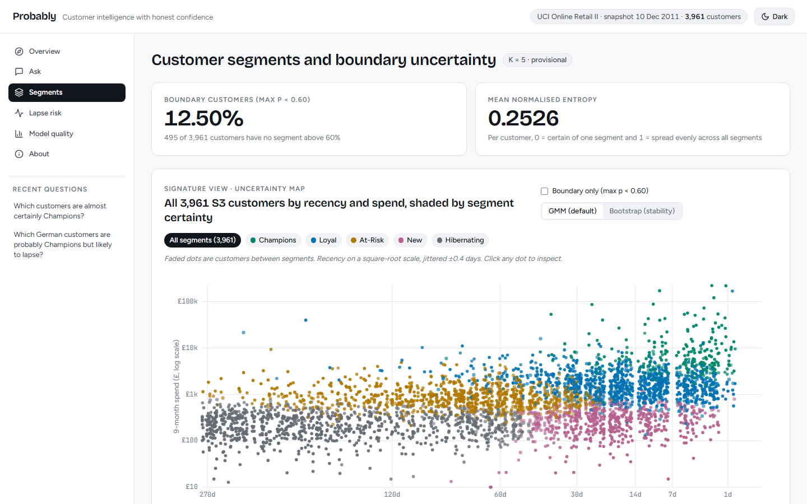 | 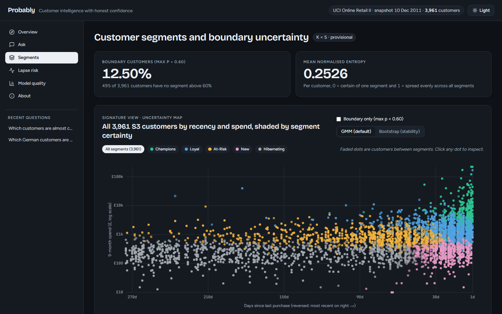 |

| **4. 90-Day Lapse Risk** (`/lapse`) · Metric tiles (Brier, Skill Score +16.72%, ROC-AUC, ECE), 10-bin reliability diagram & baseline comparison | 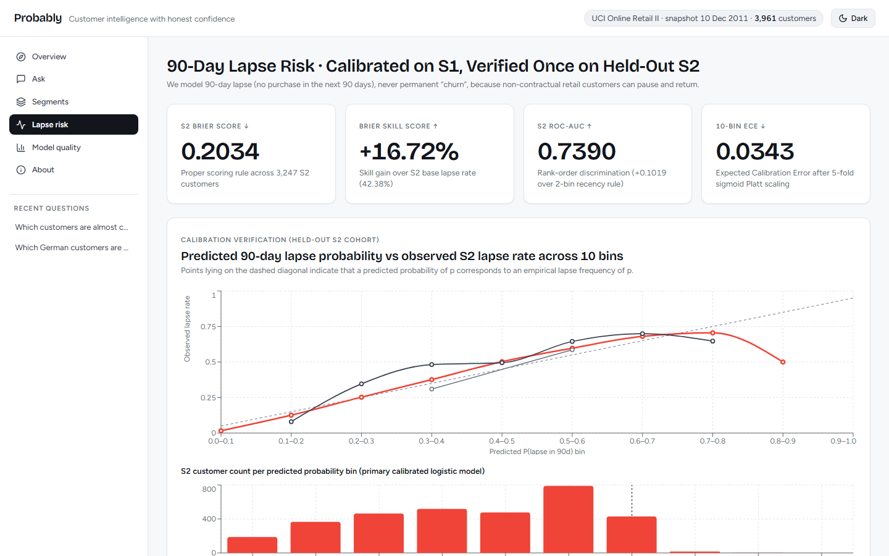 | 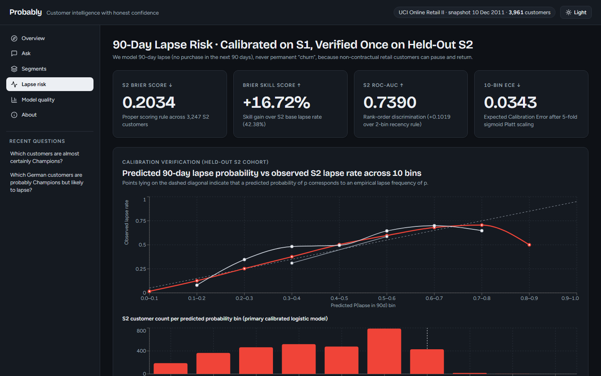 |

| **5. Model Quality** (`/quality`) · 6-step cleaning funnel horizontal bars, GMM BIC grid across 4 covariance types & bootstrap ARI histogram | 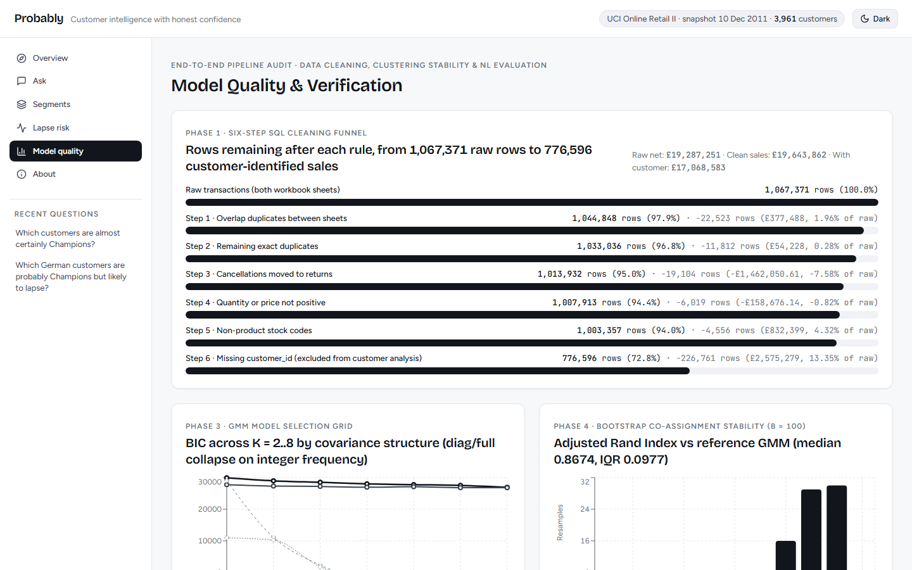 | 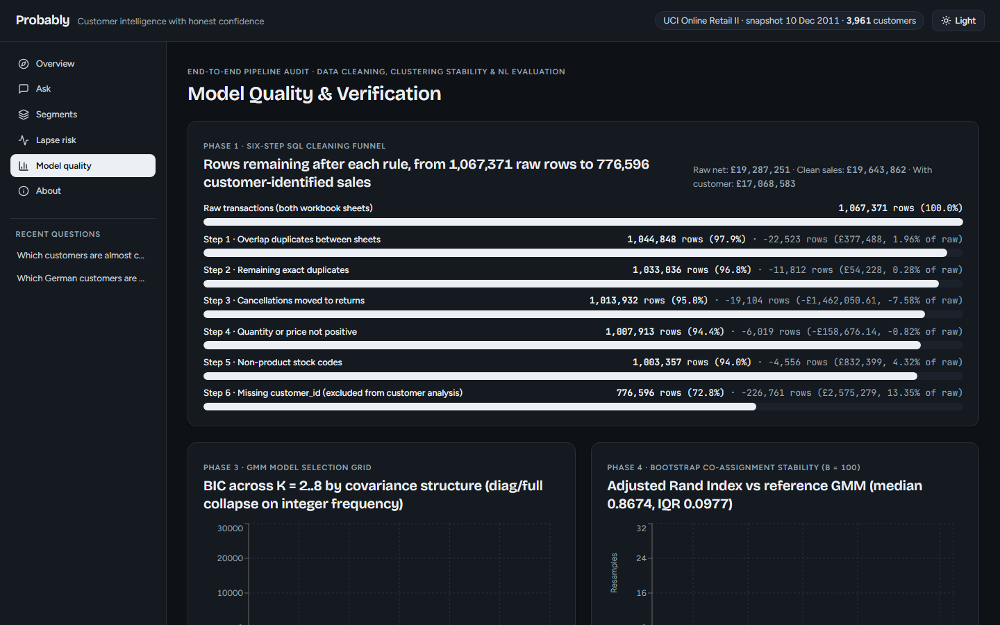 |

| **Customer Drawer** · Slide-over customer record with RFM facts, BID distribution, lapse risk gauge & surrogate tree rule | 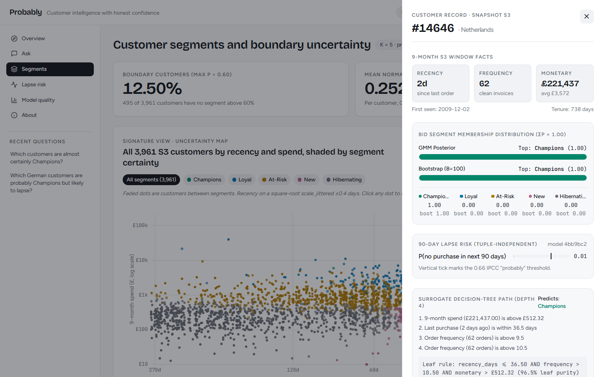 | — |


---


## Key Empirical Results


Every table below is generated automatically by [`src/report_tables.py`](src/report_tables.py) from the CSV artifacts in [`reports/tables/`](reports/tables/).


<!-- BEGIN AUTO-GENERATED RESULTS -->

### 1. Data Cleaning Funnel (`reports/tables/cleaning_funnel.csv`)

| Step | Rule | Rows Before | Rows After | Rows Removed | Revenue Affected (GBP) | % of Pre-Step Revenue | % of Raw Revenue |
|---:|---|---:|---:|---:|---:|---:|---:|
| 1 | Overlap duplicates between sheets | 1,067,371 | 1,044,848 | 22,523 | 377,488.45 | 1.96% | 1.96% |
| 2 | Remaining exact duplicates | 1,044,848 | 1,033,036 | 11,812 | 54,228.42 | 0.29% | 0.28% |
| 3 | Cancellations moved to returns | 1,033,036 | 1,013,932 | 19,104 | -1,462,050.61 | -7.75% | -7.58% |
| 4 | Quantity or price not positive | 1,013,932 | 1,007,913 | 6,019 | -158,676.14 | -0.78% | -0.82% |
| 5 | Non-product stock codes | 1,007,913 | 1,003,357 | 4,556 | 832,398.81 | 4.07% | 4.32% |
| 6 | Missing customer_id (excluded from customer analysis) | 1,003,357 | 776,596 | 226,761 | 2,575,278.90 | 13.11% | 13.35% |

- **Raw net revenue (`reports/tables/raw_totals.csv`):** `£19,287,250.57` across `1,067,371` rows.
- **Clean product sales revenue (`reports/tables/clean_sales_summary.csv`):** `£19,643,861.64` across `1,003,357` rows (`£17,068,582.74` across `776,596` customer-identified rows).

### 2. Temporal Snapshots & Base Lapse Rates (`reports/tables/snapshot_summary.csv`)

| Snapshot | Snapshot Date | Feature Window | Customers | Mean Recency (d) | Mean Frequency | Mean Monetary (GBP) | 90-Day Lapse Rate |
|---|---|---|---:|---:|---:|---:|---:|
| S1 | `2010-09-10` | `2009-12-10` to `2010-09-09` | 3,256 | 87.89 | 3.53 | 1,598.59 | 41.40% |
| S2 | `2011-09-10` | `2010-12-10` to `2011-09-09` | 3,247 | 88.36 | 3.40 | 1,555.65 | 42.38% |
| S3 | `2011-12-10` | `2011-03-10` to `2011-12-09` | 3,961 | 71.38 | 3.70 | 1,768.34 | N/A (future window) |

### 3. S3 Segment Profiles & Bootstrap Stability (`reports/tables/segment_profiles_spherical_k5.csv`)

| Segment | GMM Hard Count | Share (%) | Mean Recency (d) | Mean Frequency | Mean Monetary (GBP) | Mean AvePP | Mean Jaccard |
|---|---:|---:|---:|---:|---:|---:|---:|
| **Champions** | 258 | 6.51% | 8.60 | 18.66 | 12,635.95 | 0.8934 | 0.8669 |
| **Loyal** | 1,105 | 27.90% | 21.72 | 5.04 | 2,154.78 | 0.8490 | 0.8775 |
| **At-Risk** | 933 | 23.55% | 86.66 | 2.36 | 978.14 | 0.7880 | 0.8449 |
| **New** | 636 | 16.06% | 23.19 | 1.42 | 301.97 | 0.8086 | 0.8758 |
| **Hibernating** | 1,029 | 25.98% | 156.38 | 1.14 | 251.34 | 0.8723 | 0.9009 |

- **Bootstrap Adjusted Rand Index (B = 100):** median `0.8674` (IQR `0.0977`).
- **Decision-tree surrogate (`reports/tables/tree_fidelity.csv`):** depth `4` with `16` leaves; train fidelity `89.72%` (`n = 2,772`), held-out 30% test fidelity `86.80%` (`n = 1,189`).

### 4. Membership Probability Gate (`reports/tables/gate.csv`)

| Method | Customers | Boundary Customers (`max p < 0.60`) | Boundary Share (%) | Mean `max p` | Median `max p` | Mean Normalised Entropy |
|---|---:|---:|---:|---:|---:|---:|
| `gmm` | 3,961 | 495 | 12.50% | 0.8371 | 0.8996 | 0.2526 |
| `bootstrap` | 3,961 | 152 | 3.84% | 0.9329 | 0.9900 | 0.1041 |

### 5. Hard Counts vs Probabilistic Expected Segment Sizes (`reports/tables/kmeans_vs_expected_sizes.csv`)

| Segment | K-Means Hard Count | GMM Hard Count | GMM Expected Size `SUM(p)` | GMM SD | Bootstrap Hard Count | Bootstrap Expected Size `SUM(p)` | Bootstrap SD |
|---|---:|---:|---:|---:|---:|---:|---:|
| **Champions** | 364 | 258 | 278.63 | 7.43 | 278 | 290.55 | 5.63 |
| **Loyal** | 887 | 1,105 | 1073.79 | 14.71 | 1,116 | 1110.32 | 10.22 |
| **At-Risk** | 901 | 933 | 943.04 | 16.99 | 928 | 941.95 | 10.91 |
| **New** | 736 | 636 | 670.19 | 14.07 | 634 | 643.37 | 7.81 |
| **Hibernating** | 1,073 | 1,029 | 995.35 | 12.79 | 1,005 | 974.81 | 8.60 |

### 6. Held-Out S2 90-Day Lapse Model Evaluation (`reports/tables/lapse_s2_eval.csv`)

| Model | Test Customers (S2) | Base Lapse Rate | Mean Predicted `p` | Brier Score | Brier Skill Score | ROC-AUC | Log Loss | 10-Bin ECE |
|---|---:|---:|---:|---:|---:|---:|---:|---:|
| `logistic_calibrated` | 3,247 | 0.4238 | 0.4008 | 0.2034 | 0.1672 | 0.7390 | 0.5870 | 0.0343 |
| `tree_depth4_calibrated` | 3,247 | 0.4238 | 0.3801 | 0.2143 | 0.1225 | 0.7106 | 0.6145 | 0.0774 |
| `two_bin_recency_90d` | 3,247 | 0.4238 | 0.4125 | 0.2264 | 0.0730 | 0.6371 | 0.6448 | 0.0206 |

### 7. Natural-Language Engine Evaluation (`reports/tables/nl_summary.csv`)

| Split | Total Questions | In-Scope | Out-of-Scope | Overall Execution Accuracy | In-Scope Execution Accuracy | Template Match Rate | Out-of-Scope Rejection Rate | Hedge Threshold Accuracy |
|---|---:|---:|---:|---:|---:|---:|---:|---:|
| `dev` | 26 | 21 | 5 | 100.0% | 100.0% | 100.0% | 100.0% | 100.0% |

<!-- END AUTO-GENERATED RESULTS -->


---


## Visual Diagnostics (`reports/figures/`)


- **Data Cleaning & EDA (Phase 1):**

  - [`reports/figures/cleaning_funnel.png`](reports/figures/cleaning_funnel.png) — 6-step row and revenue funnel from `1,067,371` raw rows to `776,596` customer-identified clean sale rows.

  - [`reports/figures/eda_monthly_revenue.png`](reports/figures/eda_monthly_revenue.png) — monthly revenue trend across `2009-12` to `2011-12` showing Q4 wholesale seasonality.

  - [`reports/figures/eda_top_countries.png`](reports/figures/eda_top_countries.png) — top 10 countries by gross clean revenue.

  - [`reports/figures/eda_quantity_price.png`](reports/figures/eda_quantity_price.png) — log-scale distributions of line quantity and unit price motivating 99th-percentile capping.

- **Segmentation & Probability Gate (Phases 3–4):**

  - [`reports/figures/kmeans_selection.png`](reports/figures/kmeans_selection.png) — K-Means silhouette, Davies–Bouldin, and Calinski–Harabasz scores across `K = 2..8`.

  - [`reports/figures/gmm_bic_aic.png`](reports/figures/gmm_bic_aic.png) — GMM BIC and AIC curves across `{spherical, tied, diag, full}` covariance structures.

  - [`reports/figures/segment_profiles_s3.png`](reports/figures/segment_profiles_s3.png) — original-unit RFM profiles of the five S3 segments (`Champions`, `Loyal`, `At-Risk`, `New`, `Hibernating`).

  - [`reports/figures/gate_max_p_hist.png`](reports/figures/gate_max_p_hist.png) — distribution of maximum membership probability `max p` comparing `gmm` (`12.50%` boundary share) and `bootstrap` (`3.84%` boundary share).

- **Lapse Risk Calibration (Phase 5):**

  - [`reports/figures/lapse_reliability_s2.png`](reports/figures/lapse_reliability_s2.png) — 10-bin reliability diagram on the held-out `S2` test cohort (`n = 3,247`).


---


## Setup & Reproducibility


Requires **Python 3.12**. All random seeds are fixed to `random_state = 42` in [`src/config.py`](src/config.py).


```powershell

# 1. Create and activate a Python 3.12 virtual environment

py -3.12 -m venv .venv

.\.venv\Scripts\activate


# 2. Install pinned dependencies (including spaCy en_core_web_sm)

pip install -r requirements.txt


# 3. Download UCI Online Retail II (id 502) into data/raw/online_retail_II.xlsx

python data/download.py

```


### Running the Offline Pipeline


```powershell

# Run the complete pipeline end-to-end (Phases 1, 2, 3, 4, 5, 6, 7, 9)

python -m src.pipeline --all


# Or run a single phase

python -m src.pipeline --phase 1

```


### Launching the Web Application


The interactive user interface is a production-grade React + TypeScript single-page application served by a read-only FastAPI backend on `http://localhost:8000`.


```powershell

# 1. Single-command production launch (builds web/dist if needed, starts FastAPI on :8000)

.\run_app.bat


# 2. Or launch in development mode (FastAPI with --reload on :8000 and Vite dev on :5173)

.\run_dev.bat

```


The backend connects exclusively to [`app/app.duckdb`](app/app.duckdb) (`1.85 MB`, containing only S3 customer-level tables) with `read_only=True`.


### Running the Test Suite


```powershell

pytest -v

```


---


## Repository Structure & Documentation


- [`CLAUDE.md`](CLAUDE.md) — full project specification and viva rules.

- [`docs/PROGRESS.md`](docs/PROGRESS.md) — phase-by-phase log of completed work, real numbers, and checkpoint decisions.

- [`docs/references.md`](docs/references.md) — verified academic and technical references for the dataset, KDD process, GMM model selection, probabilistic databases (BID/tuple-independent tables, MayBMS), IPCC/Kent verbal probability scales, Spider/BIRD text-to-SQL evaluation, Dasgupta et al. explainable clustering, Hennig cluster stability, and the BG/NBD alternative.

- [`docs/how_to_write_test_questions.md`](docs/how_to_write_test_questions.md) — instructions for a human grader or teammate to populate [`eval/questions_test.csv`](eval/questions_test.csv) before final test evaluation.

- [`notebooks/presentation_walkthrough.ipynb`](notebooks/presentation_walkthrough.ipynb) — thin presentation notebook that calls `src/` modules and renders the tables and query examples for the viva.

- **Viva Explainers (`docs/explainers/`):**

  - [`docs/explainers/phase-1.md`](docs/explainers/phase-1.md) — Data Ingestion, 6-Step SQL Cleaning Funnel & EDA

  - [`docs/explainers/phase-2.md`](docs/explainers/phase-2.md) — Temporal Snapshots (`S1`, `S2`, `S3`), RFM Features & Zero-Leakage Design

  - [`docs/explainers/phase-3.md`](docs/explainers/phase-3.md) — K-Means & GMM Grid, Why `diag`/`full` Collapse on Discrete Frequency, and Segment Naming

  - [`docs/explainers/phase-4.md`](docs/explainers/phase-4.md) — BID `segment_membership`, Bootstrap Hungarian Alignment, Go/No-Go Gate & Decision-Tree Surrogate

  - [`docs/explainers/phase-5.md`](docs/explainers/phase-5.md) — Calibrated 90-Day Lapse Classifier, Held-Out `S2` Evaluation & Tuple-Independent `lapse_risk`

  - [`docs/explainers/phase-6.md`](docs/explainers/phase-6.md) — Parameterised Probabilistic SQL Templates (`Q1`–`Q6`), 10,000-World Monte Carlo Check & Read-Only `app.duckdb`

  - [`docs/explainers/phase-7.md`](docs/explainers/phase-7.md) — Rule-Based `spaCy` NL Engine, IPCC/Kent Hedge Lexicon & Execution Accuracy Evaluation

  - [`docs/explainers/phase-8.md`](docs/explainers/phase-8.md) — Initial UI Prototype, Read-Only Database Safety & Deployment Prep

  - [`docs/explainers/phase-10.md`](docs/explainers/phase-10.md) — FastAPI Read-Only Backend & React + TypeScript Web Interface

  - [`docs/DECISIONS.md`](docs/DECISIONS.md) — Documented Decisions Log (Phase 1 Revenue/Stock-Codes, Phase 3 K=5 Spherical Provisional, Phase 4 Gate & Frontend Migration)

  - [`docs/FRONTEND_REPORT.md`](docs/FRONTEND_REPORT.md) — Full Frontend Implementation Report, Screenshots & Verification Audit

  - [`docs/explainers/phase-9.md`](docs/explainers/phase-9.md) — Automated Report Tables, Traceability Verification & Viva Synthesis


---


## Licence & Data Citation


- **Dataset:** Daqing Chen (2019), *Online Retail II*, UCI Machine Learning Repository, DOI: [10.24432/C5CG6D](https://doi.org/10.24432/C5CG6D), licensed under **CC BY 4.0**. Raw data files in `data/raw/` are gitignored and never committed.

